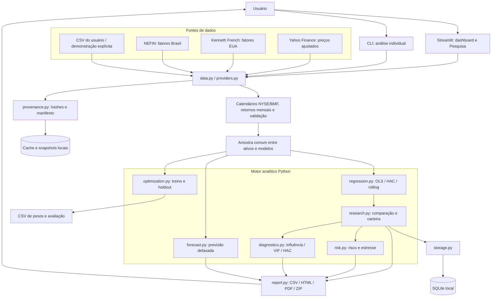

# FactorLab · Financial Research Terminal

Terminal de pesquisa quantitativa para **regressões de fatores, comparação de ativos, análise de carteiras, decomposição de risco e otimização com restrições**. Construído em Python e Streamlit, com identidade visual azul-marinho, preto, branco e verde.

Usa dados reais de **Yahoo Finance**, **Kenneth French** e **NEFIN**, além de CSV próprio e demonstração sintética explicitamente identificada. Não é uma plataforma de cotações em tempo real nem de execução de ordens.

> **[Documentação completa do projeto →](docs/PROJECT_GUIDE.md)** — arquitetura, instalação, metodologia, uso, fontes, persistência, relatórios, testes e limitações.

## Funcionalidades

| Área | Recursos |
|---|---|
| Regressões | CAPM, FF3, FF5, Carhart4 e FF5 + momentum (FF6) |
| Inferência | OLS, erros HAC/Newey–West, IC de 95%, p-valores e diagnósticos |
| Multiativos | Amostra comum, heatmap de betas, benchmark e comparação de modelos |
| Carteiras | Pesos personalizados, rebalanceamento mensal ou buy-and-hold |
| Risco | Contribuições à variância considerando covariâncias e parcela residual |
| Estresse | Choques manuais e reaplicação de fatores históricos |
| Histórico | Análises salvas em SQLite, comparação e exclusão |
| Diagnósticos avançados | VIF, correlação, Cook, leverage e sensibilidade HAC |
| Otimização | Mínima variância regularizada, limites de peso/beta e holdout |
| Avaliação | Betas móveis, walk-forward explicativo e previsão com fatores defasados |
| Exportação | CSV, HTML autônomo, PDF nativo e ZIP consolidado |
| Rastreabilidade | Manifesto de parâmetros/versões, snapshots SHA-256 e atualização de fatores |

**Mercados:** EUA/USD com Kenneth French; Brasil/BRL com NEFIN na página Pesquisa. O dataset brasileiro implementado oferece CAPM, FF3 e Carhart4, não FF5/FF6.

## Fluxo da arquitetura



**Arquitetura:** monólito modular. Streamlit e CLI chamam o mesmo núcleo Python; não há API REST própria ou frontend separado. A UI principal está em `app.py`; `pages/2_Pesquisa.py` orquestra a análise multivariada e `research_ui.py` apresenta o Risk & Portfolio Lab. Otimização tem downloads próprios; as ferramentas selecionadas adicionam tabelas aos extras do ZIP.

## Instalação rápida

### Windows / PowerShell

```powershell
git clone https://github.com/Guiandrelino/fama-french-factor-regression.git
cd fama-french-factor-regression
py -3.13 -m venv .venv
.\.venv\Scripts\python.exe -m pip install -e ".[dev]"
.\.venv\Scripts\python.exe -m streamlit run app.py
```

Abra **http://localhost:8501**. Não é necessário ativar a venv; para encerrar, use `Ctrl+C`.

### Linux / macOS

```bash
python3 -m venv .venv
.venv/bin/python -m pip install -e '.[dev]'
.venv/bin/python -m streamlit run app.py
```

Python >=3.11; CI configurado para 3.11/3.12/3.13. `pyproject.toml` define dependências; `requirements-lock.txt` registra um ambiente Windows e não é lock universal.

## Como utilizar

### Regressão individual

Na página inicial, escolha demonstração, Yahoo ou CSV, selecione o modelo e execute. Examine coeficientes, intervalos, resíduos e betas móveis.

### Pesquisa e carteira

1. Abra **Pesquisa** pela navegação lateral ou pelo link na página inicial.
2. Escolha mercado, fonte (Yahoo é o padrão), ativos, benchmark e modelos.
3. Informe pesos opcionais e política da carteira.
4. Execute e explore as comparações, avaliações e relatórios.
5. No **Risk & Portfolio Lab**, siga: **risco → estresse → análises salvas → diagnósticos → otimização**.

Exemplo de pesos:

```text
AAPL: 30%
MSFT: 30%
SPY: 40%
```

Pesos devem somar 100%, sem alavancagem. `monthly` rebalanceia mensalmente; `buy_hold` deixa os pesos variarem. Brasil exige mudar ativos, benchmark e pesos para o universo BRL (por exemplo, `BOVA11.SA`) e selecionar NEFIN.

Alterações nos controles exigem nova execução. A demonstração é sintética e ignora o intervalo de datas. Uma falha de download não ativa demonstração nem cache antigo silenciosamente.

### Formato CSV

Individual:

```csv
date,return
2020-01-31,0.025
2020-02-29,-0.04
```

Pesquisa:

```csv
date,AAPL,MSFT,SPY
2020-01-31,0.025,0.03,0.01
2020-02-29,-0.04,-0.02,-0.06
```

Exemplos apenas de formato: a regressão exige **24 meses consecutivos em comum**. Informe retornos totais simples em decimal (`0.025 = 2,5%`), na moeda dos fatores, não preços ou retornos já excedentes. A Pesquisa exige as colunas dos ativos e do benchmark. A moeda e os dividendos do CSV são responsabilidade do usuário.

### CLI

```powershell
.\.venv\Scripts\factorlab.exe --ticker SPY --model FF5 --start 2015-01-01 --end 2025-01-01 --output outputs/spy
.\.venv\Scripts\factorlab.exe --demo --model CARHART4 --output outputs/demo
.\.venv\Scripts\factorlab.exe --csv retornos.csv --model FF3 --output outputs/csv
```

Opções: `--hac-lags`, `--window`, `--refresh` e `--output`. CLI individual com fatores americanos; saídas: coeficientes, observações e rolling CSV, além de `report.json`. Yahoo usa data final exclusiva; CSV individual usa fatiamento inclusivo do pandas. O CSV da Pesquisa usa limite final exclusivo.

## Metodologia em resumo

`R_i − RF = alpha + Σ beta_k × fator_k + erro`

- OLS com intercepto e inferência t usando covariância HAC/Newey–West.
- FF3 e FF5 usam famílias de SMB diferentes; comparação não é estritamente aninhada.
- Alpha anual = `12 × alpha mensal`, não retorno composto.
- Risco inclui covariâncias: contribuição = `12 × beta_i × (Cov(F) beta)_i`.
- Walk-forward explicativo usa fatores realizados e não é previsão negociável.
- Previsão ex ante usa fatores defasados, mas não certifica disponibilidade histórica point-in-time.
- Otimização separa treino e holdout; não considera custos, impostos nem garante rentabilidade.

Detalhes: [metodologia](docs/methodology.md), [Pesquisa](docs/research.md) e [Risk & Portfolio Lab](docs/portfolio-lab.md).

## Dados, armazenamento e privacidade

- **Yahoo/yfinance:** preços ajustados; downloads sujeitos a DNS, limites e indisponibilidade.
- **Kenneth French:** fatores americanos mensais, convertidos de percentual para decimal.
- **NEFIN:** fatores brasileiros mensais value-weighted em decimal; respeite atribuição e termos do provedor.
- **Calendários:** NYSE/BMF via `pandas-market-calendars`; mês corrente e fechamentos mensais incompletos são excluídos.
- **`.cache/`:** downloads, metadados, snapshots e `analyses.sqlite`. Persistir em volume para manter dados no Docker.
- **SQLite:** histórico local compartilhado entre sessões, sem autenticação. Não publique carteiras privadas sem controle de acesso.
- **Exclusão:** remover uma análise do banco não remove os snapshots de origem.

Cache de fatores não expira automaticamente. A Pesquisa permite atualizar e sinaliza arquivos registrados há sete dias ou mais. Atualizar dados exige reexecutar a análise. Não remova `.cache/` inteira apenas para atualizar fatores se quiser preservar o histórico SQLite.

## Testes e qualidade

```powershell
.\.venv\Scripts\python.exe -m pytest -q
.\.venv\Scripts\python.exe -m pytest --cov=factorlab --cov-report=term-missing
.\.venv\Scripts\python.exe -m ruff check .
.\.venv\Scripts\python.exe -m ruff format --check .

# Upload/download real no Chromium, com dados locais controlados
.\.venv\Scripts\python.exe -m playwright install chromium
.\.venv\Scripts\python.exe -m pytest -q -m browser

# Fontes externas: EUA e Brasil
.\.venv\Scripts\python.exe -m pytest -q -m live
```

Live e browser são separados da suíte padrão. Última entrega do Portfolio Lab: **72 testes offline e teste Chromium aprovados**; a tentativa live foi interrompida após falhas DNS, portanto não é declarada aprovada nessa entrega. [Histórico de validação](docs/validation.md).

GitHub Actions configura Python 3.11/3.12/3.13, lint/formato, cobertura, Chromium e smoke test Docker; live roda semanalmente ou por disparo manual. Aprovação de uma execução anterior não garante aprovação de commits posteriores.

## Docker

```bash
docker build -t factorlab .
docker run --rm -p 8501:8501 -v factorlab-cache:/app/.cache factorlab
```

Container com usuário não root e healthcheck. Não inclui autenticação ou HTTPS; para acesso externo, configure proxy e controles de segurança.

## Estrutura do repositório

```text
.streamlit/config.toml       Tema e configuração Streamlit
.github/workflows/quality.yml CI: testes, cobertura, navegador e Docker
app.py                       Dashboard individual
pages/2_Pesquisa.py           Workspace multiativos e carteira
src/factorlab/
  data.py / providers.py      Fontes, calendários e contratos dos dados
  regression.py              Regressões e inferência
  research.py / forecast.py  Comparações, carteiras e avaliações
  risk.py / diagnostics.py   Risco, estresse e diagnósticos
  optimization.py            Alocação com restrições e holdout
  storage.py / provenance.py SQLite, snapshots e manifesto
  report.py                  Relatórios e exportação
  ui.py / research_ui.py      Identidade visual e ferramentas do terminal
  cli.py                     Interface de linha de comando
tests/                       Unitários, integração e navegador
docs/                        Documentação técnica e funcional
Dockerfile                   Imagem de execução
```

## Documentação

- **[Guia completo do projeto](docs/PROJECT_GUIDE.md)**
- [Metodologia econométrica](docs/methodology.md)
- [Página Pesquisa e fontes](docs/research.md)
- [Risk & Portfolio Lab](docs/portfolio-lab.md)
- [Validação e histórico de execução](docs/validation.md)

**Uso educacional e analítico; não é recomendação de investimento.** R² elevado e alpha significativo não garantem retornos futuros. Dados públicos podem ser revisados; não há execução de ordens nem backtest investível point-in-time certificado.
