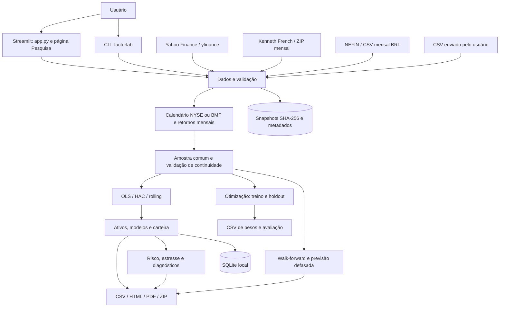

# FactorLab — documentação completa do projeto

## Sumário

1. [Objetivo e escopo](#1-objetivo-e-escopo)
2. [Arquitetura](#2-arquitetura)
3. [Instalação e operação](#3-instalação-e-operação)
4. [Fontes e contratos dos dados](#4-fontes-e-contratos-dos-dados)
5. [Regressões e interpretação](#5-regressões-e-interpretação)
6. [Fluxo do usuário](#6-fluxo-do-usuário)
7. [Carteiras e comparação](#7-carteiras-e-comparação)
8. [Risco, estresse e diagnósticos](#8-risco-estresse-e-diagnósticos)
9. [Walk-forward e previsão](#9-walk-forward-e-previsão)
10. [Otimização](#10-otimização)
11. [Persistência e rastreabilidade](#11-persistência-e-rastreabilidade)
12. [Relatórios e exportação](#12-relatórios-e-exportação)
13. [Testes, CI e Docker](#13-testes-ci-e-docker)
14. [Segurança, limitações e solução de problemas](#14-segurança-limitações-e-solução-de-problemas)
15. [Manutenção e extensões](#15-manutenção-e-extensões)

## 1. Objetivo e escopo

FactorLab é uma aplicação de pesquisa quantitativa em Python para investigar como fatores de risco explicam retornos mensais de ativos e carteiras. Oferece interface Streamlit com estética de terminal financeiro e uma CLI para análises individuais.

Responde a perguntas como: quais exposições explicam os retornos? O alpha é distinguível de zero? Os betas são estáveis? Qual a contribuição dos fatores ao risco? Como uma carteira responderia a choques? Uma alocação de mínima variância se comporta melhor que a equiponderada no período de avaliação?

Não é plataforma de execução de ordens, fonte de cotações em tempo real, recomendação de investimento ou garantia de retorno. O modo de demonstração é explicitamente sintético. Dados reais dependem de fontes externas e não são substituídos silenciosamente por números simulados.

## 2. Arquitetura

Aplicação monolítica modular: a interface chama funções Python no mesmo processo; não há API REST própria nem frontend React separado. APIs/downloads externos são consumidos no backend Python.



### Mapa dos módulos

| Arquivo | Responsabilidade |
|---|---|
| `app.py` | Dashboard de regressão individual em USD |
| `pages/2_Pesquisa.py` | Orquestra análise multivariada, carteira, modelos e exportação |
| `src/factorlab/ui.py` | CSS compartilhado, cabeçalho, cards e template Plotly |
| `.streamlit/config.toml` | Tema escuro, cores e configurações do servidor |
| `data.py` | Download, retry Yahoo, cache de fatores, parser French, CSV e retornos mensais |
| `providers.py` | Adapter NEFIN mensal value-weighted |
| `regression.py` | OLS, inferência HAC, diagnósticos básicos e betas móveis |
| `research.py` | Validação do painel, pesos, carteira, comparação e walk-forward explicativo |
| `forecast.py` | Previsão de retorno com fatores defasados |
| `risk.py` | Decomposição de variância e cenários de estresse |
| `diagnostics.py` | Correlação, VIF, influência e sensibilidade HAC |
| `optimization.py` | Mínima variância regularizada e avaliação holdout |
| `storage.py` | Histórico local SQLite e comparação de resumos |
| `provenance.py` | Hashes, snapshots, manifesto e idade do cache |
| `report.py` | Relatórios HTML/PDF e pacote ZIP |
| `research_ui.py` | Interface das cinco ferramentas Risk & Portfolio Lab |
| `cli.py` | Argumentos de terminal e exportação individual |

Os caminhos dos módulos da tabela, quando abreviados, são relativos a `src/factorlab/`.

### Ciclo de execução

1. O usuário informa fonte, ativos, modelos, datas e parâmetros.
2. O backend obtém preços/fatores ou lê o CSV; guarda evidências da origem quando aplicável.
3. Preços ajustados viram retornos mensais; fatores são normalizados em datas e unidades.
4. A análise usa meses em comum e exige continuidade; não preenche retornos ausentes.
5. Na Pesquisa, a carteira é construída no início da amostra comum.
6. Regressões, tabelas, rolling e avaliações são calculados e colocados em `st.session_state`.
7. Ferramentas adicionais operam sobre a última análise executada.
8. O usuário exporta resultados ou salva o resumo no SQLite.

Streamlit reexecuta o script a cada interação. A análise principal permanece em sessão até nova execução; uma tentativa de execução que falha remove o resultado principal anterior. Alterar parâmetros sem executar não recalcula a amostra. A página inicial usa cache em memória de uma hora para downloads; os fatores também têm cache em disco. A Pesquisa expõe atualização explícita de fatores.

## 3. Instalação e operação

### Windows / PowerShell

```powershell
git clone https://github.com/Guiandrelino/fama-french-factor-regression.git
cd fama-french-factor-regression
py -3.13 -m venv .venv
.\.venv\Scripts\python.exe -m pip install -e ".[dev]"
.\.venv\Scripts\python.exe -m streamlit run app.py
```

Abra `http://localhost:8501`. Não é necessário ativar o ambiente. Para ativar opcionalmente: `.\.venv\Scripts\Activate.ps1`. Para encerrar o servidor iniciado no terminal: `Ctrl+C`.

### Linux / macOS

```bash
python3 -m venv .venv
.venv/bin/python -m pip install -e '.[dev]'
.venv/bin/python -m streamlit run app.py
```

Python suportado pela configuração: >=3.11; matriz do CI: 3.11, 3.12 e 3.13. `pyproject.toml` define intervalos de versões; `requirements-lock.txt` registra um ambiente local Windows e não substitui lock multiplataforma. NumPy está limitado a `<2.4` para compatibilidade com pandas 2.x. SciPy é dependência explícita da otimização.

### CLI

```powershell
.\.venv\Scripts\factorlab.exe --ticker SPY --model FF5 --start 2015-01-01 --end 2025-01-01 --output outputs/spy
.\.venv\Scripts\factorlab.exe --demo --model CARHART4 --output outputs/demo
.\.venv\Scripts\factorlab.exe --csv retornos.csv --model FF3 --output outputs/csv
```

Fontes mutuamente exclusivas: `--ticker`, `--csv`, `--demo`. Modelos: CAPM, FF3, FF5, CARHART4 e FF6. Opções adicionais: `--hac-lags`, `--window`, `--refresh`, `--output`. A CLI é individual e usa fatores americanos; não expõe as ferramentas de carteira/otimização/NEFIN do dashboard.

## 4. Fontes e contratos dos dados

| Origem | Conteúdo | Mercado / unidade |
|---|---|---|
| Yahoo via yfinance | Fechamento diário com `auto_adjust=True` | Moeda do ticker; EUA/USD ou Brasil/BRL conforme contexto |
| Kenneth French | Fatores mensais e RF; momentum separado | EUA, percentuais convertidos para decimais |
| NEFIN | Fatores mensais value-weighted | Brasil, decimais em BRL |
| CSV | Retornos totais simples mensais já preparados | Moeda deve coincidir com o mercado selecionado |
| Demonstração | Séries reproduzíveis com seeds fixas | Sintético; não representa os tickers nomeados |

### CSV individual

```csv
date,return
2020-01-31,0.025
2020-02-29,-0.04
```

### CSV multivariado da Pesquisa

```csv
date,AAPL,MSFT,SPY
2020-01-31,0.025,0.03,0.01
2020-02-29,-0.04,-0.02,-0.06
```

Os exemplos ilustram apenas o formato; não contêm os 24 meses necessários. `0.025` = 2,5%. Não enviar preços, retornos logarítmicos ou retornos já subtraídos de RF. O usuário deve assegurar dividendos, moeda e completude; essas propriedades não podem ser inferidas de um CSV.

Datas são normalizadas para fim do mês. Duplicatas, datas ausentes, infinito e retornos menores que -100% são rejeitados. O painel multivariado rejeita valores ausentes. Na regressão, NaN é removido, mas uma lacuna interna remanescente causa erro. Exigem-se pelo menos 24 meses comuns, consecutivos e matriz de fatores de posto completo.

### Preços → retornos

O último fechamento de cada mês deve coincidir com a última sessão esperada no calendário NYSE/BMF do `pandas-market-calendars`. O pacote implementa regras das bolsas, mas não é um serviço oficial. O mês corrente é excluído. Retorno = `P_m / P_(m-1) - 1`; o primeiro mês fornece somente a base, portanto a consulta deve começar antes do primeiro retorno desejado. Não se verifica a presença de todos os pregões internos.

`end` é exclusivo para Yahoo e para o filtro CSV da Pesquisa. O CSV individual da CLI/página inicial usa fatiamento inclusivo do pandas. A demonstração ignora datas selecionadas.

Yahoo tem até três tentativas com espera progressiva; falhas podem continuar. Cache antigo ou demonstração não entram silenciosamente no lugar do download.

### Mercado brasileiro

Na Pesquisa selecione Brasil/BRL. Para Yahoo, use tickers `.SA`, por exemplo `PETR4.SA`, `VALE3.SA`, `BOVA11.SA`; ajuste também pesos e benchmark. O adapter NEFIN mapeia `Rm_minus_Rf`, `WML` e `Risk_Free` para `Mkt-RF`, `Mom` e `RF`. Usa o spread mensal publicado, não compõe spreads diários. IML não é incluído nos modelos. Esse dataset não fornece RMW/CMA: não há FF5/FF6 brasileiro implementado.

Fonte: [NEFIN Risk Factors](https://nefin.com.br/data/risk-factors/). A página informa dados disponíveis gratuitamente para acadêmicos e profissionais e solicita citação. Confirme condições de redistribuição comercial com o provedor; não se presume licença irrestrita.

## 5. Regressões e interpretação

Modelo geral:

`R_i,t - RF_t = alpha + Σ beta_k F_k,t + epsilon_t`

| Modelo | Fatores |
|---|---|
| CAPM | Mkt−RF |
| FF3 | Mkt−RF, SMB, HML |
| FF5 | Mkt−RF, SMB, HML, RMW, CMA |
| CARHART4 | FF3 + Mom |
| FF6 | FF5 + Mom; nome usado pelo projeto para essa extensão |

SMB mede tamanho; HML, valor; RMW, rentabilidade; CMA, investimento; Mom, momentum. Betas são adimensionais; alpha e fatores estão em decimal mensal. O SMB de FF3 e FF5 tem construção diferente: comparar as famílias não é um teste simples de modelos estritamente aninhados.

Coeficientes são OLS com intercepto. Erros-padrão usam HAC/Newey–West, kernel Bartlett padrão, defasagens configuráveis e inferência t (`use_t=True`). HAC modifica a inferência, não os coeficientes. IC de 95% inclui zero: não há evidência suficiente de alpha diferente de zero segundo esse procedimento. IC fora de zero não prova habilidade ou persistência.

Métricas: R², R² ajustado, alpha mensal/anual aritmético (`12 × alpha`), volatilidade residual, RMSE, AIC/BIC convencionais e número de condição. Anualização não é retorno composto. Diagnósticos básicos: Jarque–Bera, Breusch–Pagan, Ljung–Box e Durbin–Watson. Consulte [methodology.md](methodology.md) para hipóteses e detalhes.

## 6. Fluxo do usuário

### Página inicial

Use para investigar um ativo: selecione fonte, modelo, ticker/CSV, datas, HAC e janela; execute; examine coeficientes, ajuste, resíduos e rolling; baixe CSVs. Por padrão abre em demonstração, sem internet.

### Pesquisa

1. Selecione EUA/USD ou Brasil/BRL.
2. Escolha Yahoo (padrão), CSV ou demonstração.
3. Informe ativos, benchmark e modelos.
4. Defina pesos opcionais, política da carteira, HAC, janela de treino e lag da previsão.
5. Execute a pesquisa.
6. Explore comparação, carteira, estabilidade, walk-forward e relatórios.
7. Use Risk & Portfolio Lab na ordem risco → estresse → análises salvas → diagnósticos → otimização.

A fonte de cada execução consta no manifesto; demonstração exibe aviso. O tema azul-marinho/preto/branco/verde é compartilhado por CSS e template Plotly. Layouts menores reorganizam os cards; não existe feed de preços ao vivo no cabeçalho.

## 7. Carteiras e comparação

Pesos: um por linha, `AAPL: 30%` ou `AAPL: 0.3`. Ativos precisam existir no painel, pesos são finitos, não negativos e somam 100%. Campo vazio desativa carteira.

- `monthly`: pesos retornam à alocação definida no começo de cada mês.
- `buy_hold`: quantidades iniciais são mantidas; pesos variam conforme patrimônio acumulado. Se a carteira ficar sem patrimônio e os pesos se tornarem indefinidos, a análise é rejeitada.

A carteira começa na amostra comum de todos os modelos/ativos, não antes. Dividendos são representados pelos retornos ajustados; não há conta caixa, custos, impostos, aportes ou negociação. O benchmark também entra na amostra comum.

Tracking error = `std(retorno ativo - benchmark) × sqrt(12)`. Retorno ativo anual aritmético = `12 × média da diferença mensal`. Não é alpha contra benchmark. `rolling_std_*` mede dispersão descritiva de coeficientes em janelas sobrepostas, não é teste formal de estabilidade.

## 8. Risco, estresse e diagnósticos

### Decomposição

`Contribuição_i = 12 × beta_i × (Cov(F) beta)_i`.

A matriz inclui correlações entre fatores. Contribuições negativas são possíveis. Soma sistemática + variância residual reconcilia a variância do retorno excedente dentro da amostra OLS. Para reconciliar, a variância residual nesta ferramenta usa ddof=1, diferente da estimativa corrigida pelo número de parâmetros no resumo da regressão. Anualização ×12 é convenção sem autocovariâncias; não é previsão de risco.

### Estresse

Choques manuais representam retornos mensais de fatores, em percentuais. Impacto = `Σ beta × choque`, excluindo alpha, RF e resíduo na interface atual. Cenários históricos reaplicam fatores observados aos betas atuais, sem reconstruir as posições e os betas da época. Não são VaR, perda máxima ou simulação integral da carteira. Se o período não estiver na amostra, o sistema informa a ausência.

### Diagnósticos avançados

Correlação, VIF com constante, distância de Cook, leverage, resíduos studentizados internos e IC/p-valores de alpha sob diferentes lags HAC. Cook >4/n é apenas sinal de inspeção; não se excluem observações automaticamente. Diagnósticos de influência são OLS convencionais. Não há teste formal de quebra estrutural nesta etapa.

## 9. Walk-forward e previsão

Duas avaliações distintas:

| Avaliação | Preditores | Interpretação |
|---|---|---|
| Walk-forward explicativo | Betas treinados no passado × fatores realizados no mês avaliado | Ajuste retrospectivo fora da amostra; não previsão negociável |
| Previsão ex ante | Retorno total t explicado por fatores t−L | Não usa fatores contemporâneos; compara com média histórica do treino |

Janela de treinamento mínima de 24 meses. O lag L é configurável, padrão dois meses. Exportações indicam fim do treino, mês do fator, respostas e erros. Reexecute com diferentes janelas para avaliar sensibilidade.

A previsão defasada não certifica disponibilidade point-in-time: datas históricas de publicação e revisões dos fatores não estão integralmente arquivadas. Não há promessa de superar a média histórica nem de gerar lucro. Seleção de ativos e ajuste repetido de parâmetros também podem gerar viés.

## 10. Otimização

Objetivo: minimizar `w' Σ_regularizada w` via SciPy/SLSQP.

Restrições: pesos ≥0, soma=1, máximo por ativo, limites opcionais de beta de mercado. Covariância regularizada em direção à diagonal e pequeno termo numérico estabilizador. Restrições inviáveis ou falta de convergência geram mensagem de erro.

Treino mínimo 24 meses e avaliação mínima 12 meses. A UI estima betas e covariância somente no treino. Holdout não participa da escolha dos pesos. Pesos são aplicados com rebalanceamento mensal, comparados à carteira equiponderada. A função de baixo nível aceita exposições externas; quem a chamar fora da UI deve preservar a separação treino/teste.

Resultado ótimo dentro da amostra não garante bom desempenho futuro. Sem custos, impostos, liquidez ou limites setoriais. Betas realizados no teste podem romper limites estimados. O universo previamente selecionado pode conter viés de sobrevivência.

## 11. Persistência e rastreabilidade

| Local | Conteúdo |
|---|---|
| `.cache/*.zip` / CSV de fatores | Última cópia em disco dos downloads |
| `.cache/*.meta.json` | URL, timestamp, hash e tamanho do download |
| `.cache/snapshots/<sha256>` | Evidências de conteúdo dos arquivos/séries |
| `.cache/analyses.sqlite` | Histórico de análises salvas |
| `st.session_state` | Último estudo da sessão e extras selecionados |
| `outputs/` | Exportações CLI e logs locais quando usados |

Manifesto inclui parâmetros, versões de bibliotecas, fonte e hashes dos inputs. SHA-256 identifica conteúdo, não certifica autenticidade. Cache de fatores não expira automaticamente; idade >=7 dias gera alerta na Pesquisa. Botão de atualizar baixa fatores novamente; é preciso reexecutar a pesquisa para recalcular resultados. Arquivos legados têm timestamp de registro explicitamente identificado.

SQLite armazena nome, data UTC, manifesto, resumo e retornos em formatos JSON/CSV. Não armazena um objeto Python executável; carregar uma análise mostra o resumo, não restaura automaticamente todos os resultados calculados. Comparação faz segunda menos primeira para linhas/colunas numéricas comuns: conferir mercado, moeda, fonte e datas antes de interpretar. Exclusão da análise não apaga snapshots.

O banco é local, compartilhado entre sessões, sem autenticação ou isolamento por usuário. Backups devem incluir banco e snapshots, preferencialmente com a aplicação parada. Esses dados ficam fora do Git.

## 12. Relatórios e exportação

- Página inicial/CLI: coeficientes, observações e rolling CSV; CLI inclui `report.json`.
- Pesquisa: resumo CSV, HTML autônomo, PDF nativo ReportLab e ZIP consolidado.
- HTML: gráfico interativo com Plotly incorporado, equações numéricas, tabelas, diagnósticos, interpretação e manifesto.
- PDF: gráfico vetorial, modelo/coeficientes, métricas, interpretação e rastreabilidade; sem serviço externo.
- ZIP: resumo, retornos, manifesto, HTML/PDF, coeficientes/rolling/observações por análise, extras de walk-forward e ferramentas selecionadas.
- Otimização: downloads próprios dos pesos e do holdout. Não é automaticamente incluída no relatório principal.

As ferramentas de risco/estresse/diagnóstico adicionam tabelas aos extras da sessão com identificadores. Relatórios HTML/PDF principais não incluem automaticamente gráficos de todas essas ferramentas. O salvamento SQLite armazena resumo/retornos/parâmetros, não o pacote completo de relatórios. Para preservar todos os artefatos, baixe também o ZIP.

## 13. Testes, CI e Docker

```powershell
.\.venv\Scripts\python.exe -m pytest -q
.\.venv\Scripts\python.exe -m pytest --cov=factorlab --cov-report=term-missing
.\.venv\Scripts\python.exe -m ruff check .
.\.venv\Scripts\python.exe -m ruff format --check .
.\.venv\Scripts\python.exe -m playwright install chromium
.\.venv\Scripts\python.exe -m pytest -q -m browser
.\.venv\Scripts\python.exe -m pytest -q -m live
```

Por padrão, live/browser são excluídos. Warnings Python viram erros. Testes determinísticos cobrem regressões, parâmetros conhecidos, contratos de dados, carteiras, previsão, exportação, SQLite, risco, diagnósticos e otimização sem uso do holdout na escolha dos pesos. Chromium exercita upload real e download. Live verifica 20 combinações EUA e três Brasil; depende da rede e do provedor, não é substituto dos testes determinísticos.

`.github/workflows/quality.yml` executa lint, formato, testes e cobertura em Python 3.11/3.12/3.13; há jobs de navegador e Docker. Live roda semanalmente ou por disparo manual. Evidências e o estado de cada entrega estão em [validation.md](validation.md). Uma execução antiga aprovada não implica que commits posteriores já foram validados remotamente.

```bash
docker build -t factorlab .
docker run --rm -p 8501:8501 -v factorlab-cache:/app/.cache factorlab
```

Docker usa Python 3.13 slim, usuário não root, tema compartilhado e healthcheck HTTP. Volume preserva fatores e SQLite. Não há HTTPS/autenticação no container: use proxy e controles apropriados para disponibilização externa. A imagem instala intervalos de dependências do projeto, não um lock imutável.

## 14. Segurança, limitações e solução de problemas

| Sintoma | Ação recomendada |
|---|---|
| Python não encontrado no Windows | Usar `py -3.13` e o executável completo da venv |
| PowerShell bloqueia ativação | Executar diretamente `.venv\Scripts\python.exe`, sem alterar política global |
| Porta 8501 ocupada | Encerrar processo anterior ou usar `--server.port=8502` |
| DNS/timeout Yahoo | Verificar internet/DNS/proxy, tentar novamente; CSV verificado é alternativa explícita |
| Menos de 24 meses | Aumentar período ou escolher ativo com histórico suficiente |
| Meses ausentes | Revisar a origem, calendário, listagem/suspensão; não preencher artificialmente retornos |
| Otimização inviável | Aumentar máximo por ativo ou relaxar limites de beta; garantir 24+12 meses |
| Dados antigos | Atualizar fatores e executar novamente a análise |
| Navegador sem Chromium | Executar `python -m playwright install chromium` |
| Visual antigo | Atualizar navegador; confirmar execução na venv e diretório corretos |

Uploads e snapshots podem conter informações financeiras privadas. Não há expiração automática, criptografia de aplicação ou quotas por usuário. Não publique a pasta `.cache/`; restrinja acesso, retenção e backups. Relatórios exportados também carregam informações sobre fontes e parâmetros.

Limitações financeiras: seleção/sobrevivência, modelos omitidos, não linearidades, mudanças de regime, inferência assintótica em amostras pequenas, múltiplos testes sem correção, revisões de dados e indisponibilidade point-in-time. R² elevado não implica rentabilidade; alpha significativo não implica causalidade/habilidade. Calendários e fontes públicas podem divergir. Não há execução, custos, gestão completa de risco ou conformidade regulatória.

## 15. Manutenção e extensões

Para adicionar um modelo, atualizar `MODELS`, seus providers, seletores UI/CLI e testes de fatores presentes/amostra. Para uma nova fonte, criar adapter com datas de fim de mês, retornos decimais e metadados; não misturar moedas. Para novas ferramentas, separar cálculo e UI e escrever testes determinísticos de identidades/limites e ausência de vazamento.

Preservar commits pequenos, manter dados privados fora do Git e validar testes antes do push. Antes de transformar em serviço multiusuário: autenticação, banco/arquivos isolados, limites de upload/ativos, políticas de retenção, tarefas em background e observabilidade.

### Referências complementares

- [Metodologia econométrica](methodology.md)
- [Guia da Pesquisa](research.md)
- [Risk & Portfolio Lab](portfolio-lab.md)
- [Histórico de validação](validation.md)
- [Kenneth French Data Library](https://mba.tuck.dartmouth.edu/pages/faculty/ken.french/data_library.html)
- [NEFIN](https://nefin.com.br/data/risk-factors/)
- [yfinance](https://github.com/ranaroussi/yfinance)
